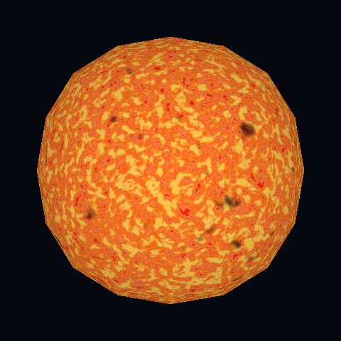
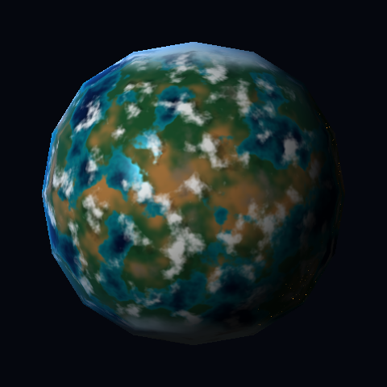
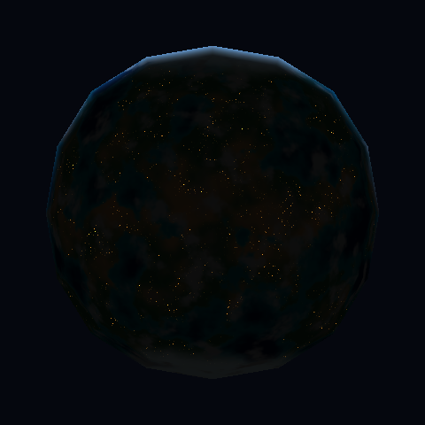
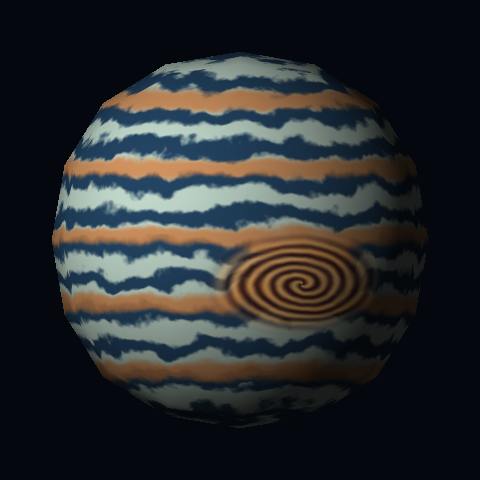

# Atlas celeste — Laboratorio 6

Tres apariencias procedurales en **Rust + raylib**, calculadas por un rasterizador de triángulos en **CPU**. Una sola malla: [`assets/sphere.obj`](assets/sphere.obj), proporcionada por el usuario. No se cargan texturas, mapas ni materiales externos. La textura de raylib es únicamente el framebuffer que ya calculó la CPU.

## Compilar y ejecutar

En Windows se necesitan Rust estable (MSVC), Visual Studio Build Tools con el componente de C++, CMake y LLVM (libclang para los bindings de raylib 5.5). Instalación desde PowerShell:

```powershell
winget install --id Microsoft.VisualStudio.2022.BuildTools -e --override "--wait --quiet --add Microsoft.VisualStudio.Workload.VCTools --includeRecommended"
winget install --id Rustlang.Rustup -e
winget install --id Kitware.CMake -e
winget install --id LLVM.LLVM -e
```

Abrir una terminal nueva después de instalar. Desde la raíz del repositorio:

```powershell
cargo run --release
```

También puedes usar `powershell -ExecutionPolicy Bypass -File .\ejecutar.ps1`; el script localiza las herramientas instaladas en sus rutas habituales. Para regenerar evidencias: `powershell -ExecutionPolicy Bypass -File .\ejecutar.ps1 -Capturas`.

Si bindgen no encuentra libclang: `$env:LIBCLANG_PATH = 'C:\Program Files\LLVM\bin'`. Si CMake no aparece en PATH: `$env:Path = 'C:\Program Files\CMake\bin;' + $env:Path`.

Usar `--release`: el ruido fractal por fragmento es costoso en modo debug. `cargo test --release` comprueba la rasterización de la malla real, valores finitos en los materiales y la emisión y animación de Helios. `cargo run --release -- --smoke` abre la ventana, presenta tres frames y sale.

| Tecla | Acción |
| --- | --- |
| 1 / 2 / 3 | Estrella / rocoso / gaseoso |
| Espacio | Pausar el tiempo del material |
| Izquierda / derecha | Girar el modelo para inspeccionarlo |
| G | Ver la luminancia en escala de grises |
| L | Activar/desactivar la luz móvil |
| R | Restablecer tiempo, orientación y luz |
| Esc | Salir |

Para regenerar las imágenes y GIF, sin abrir una ventana:

```powershell
cargo run --release -- --capture
```

El programa también acepta `--mesh ruta/a/esfera.obj`. Los tres shaders siempre comparten la misma malla. Se centra y escala mediante la transformación de modelo, sin desplazar vértices para generar detalles. El archivo original no se modifica. Se ignora la referencia `sphere.mtl` del OBJ porque no se usan materiales externos.

## Los tres cuerpos

### Helios — estrella de plasma



El ruido de baja frecuencia deforma las coordenadas de un ruido más fino: los gránulos no son simples manchas independientes. Una onda sobre ese campo añade filamentos claros. Otro campo con umbrales suaves genera manchas frías. Los tonos cambian de rojo a amarillo y crema según la temperatura aparente. La estrella es emisiva y no depende de la luz externa; el borde se enfría ligeramente.

Implementación: [`stars::sun`](src/shaders/stars.rs). Parámetros: `19.0` cambia el tamaño de los gránulos; `2.6` la deformación; los umbrales `-0.38, -0.19` la extensión de las manchas; `time * 0.14` la velocidad del plasma. La advección del campo cambia el material sin rotar la geometría.

[Ver animación de Helios](docs/helios.gif).

### Nereida — océanos y continentes



Un fBm de cinco octavas define altura aparente. Una transición suave alrededor de cero separa océanos y tierra; otras máscaras asignan aguas someras, zonas secas, montañas y hielo polar. El relieve es un patrón de color, no desplazamiento ni bump mapping. El océano tiene un reflejo especular restringido por la máscara de agua.

Las nubes usan un campo distinto en coordenadas que giran con el tiempo, mientras los continentes permanecen fijos. Para sombrear el terreno se intersecta analíticamente un rayo hacia la luz con una capa esférica de radio `1 + 0.075` y se consulta allí la misma máscara de nubes. No se agrega otra esfera al modelo: es un cálculo matemático. La dirección de la luz determina el desplazamiento de las sombras. Un término de borde dependiente de la vista y de la luz simula atmósfera dentro de la silueta.

De noche aparecen asentamientos ámbar sobre la tierra, excluyendo océanos y hielo. Dos campos de ruido forman agrupaciones y puntos finos; la emisión se activa con `1 - smoothstep(-0.22, 0.02, normal · luz)`. Las nubes ocultan las luces. No es simplemente iluminación difusa: el patrón emisivo desaparece de día. `145.0` controla el tamaño de los puntos, `0.23, 0.48` su densidad y `2.4` su brillo. Para comprobarlo, presionar **2, Espacio y L**: el material queda quieto mientras la luz recorre día y noche.



Implementación: [`planets::rocky` y `clouds`](src/shaders/planets.rs). Parámetros: `2.8` cambia la escala continental; `-0.035, 0.025` las costas; `0.77, 0.9` los casquetes; `6.8` el tamaño de las nubes; `0.065` su velocidad; `0.075` la separación aparente de su sombra; `75.0` la concentración del reflejo; `3.5` el grosor visual del borde atmosférico.

[Nubes en movimiento](docs/nereida.gif) · [Respuesta a la luz](docs/luz.gif).

### Zéfiro — gigante de bandas fluidas



Ondas de latitud mezclan bandas azul grisáceo, crema y cobre. Antes de evaluarlas se distorsionan con ruido fractal: sus límites ondulan y se mezclan suavemente. Una región elíptica transforma las coordenadas en un vórtice con filamentos espirales y anillos turbulentos. El giro interno y la advección lenta animan la atmósfera.

Implementación: [`planets::gas`](src/shaders/planets.rs). Parámetros: `37.0` controla la cantidad de bandas; `0.08` su ondulación; `0.43, 0.22` el tamaño de la tormenta; `4.0` la torsión; `24.0` el número de filamentos; `time * 0.22` su velocidad.

[Ver animación de Zéfiro](docs/zefiro.gif).

## Efectos presentados para evaluación

Según la rúbrica, esta entrega solicita **120 puntos posibles: 60 base + 60 adicionales**, con nota máxima de **100**. Es una correspondencia de implementación con criterios, no una nota garantizada; el profesor puede otorgar crédito parcial por el resultado observable. Cada efecto se solicita una sola vez. Las nubes móviles no se vuelven a contar como material animado.

| Criterio de la rúbrica | Puntos solicitados | Evidencia / implementación |
| --- | ---: | --- |
| Estrella procedural propia | 10 | Helios |
| Rocoso con regiones diferenciadas | 10 | Nereida |
| Gigante con bandas atmosféricas | 10 | Zéfiro |
| Diseño visual | 20 | Paletas y capturas de los tres cuerpos |
| Entrega | 10 | Repositorio, instrucciones, capturas y parámetros |
| Material animado | 5 | [Helios](docs/helios.gif), `stars::sun` |
| Apariencia de día y noche | 5 | [Luz móvil](docs/luz.gif), `planets::night_lights` y `night_mask` |
| Respuestas diferentes a la iluminación | 10 | [Luz móvil](docs/luz.gif), océano especular y tierra mate en `planets::rocky` |
| Nubes procedurales | 10 | [Nereida](docs/nereida.gif), `planets::clouds`; umbrales `0.02, 0.28` ajustan cobertura |
| Tormenta o vórtice localizado | 10 | [Zéfiro](docs/zefiro.gif), `planets::gas`; distorsión de bandas dentro de la máscara elíptica |
| Sombras de nubes | 20 | [Luz móvil](docs/luz.gif), `planets::cloud_shadow`; altura `0.075` controla separación |
| **Total solicitado** | **120** | **Nota máxima: 100** |

No se solicitan bump mapping ni parallax (30 puntos restantes). Las normales radiales suaves no son bump mapping; girar la esfera no es parallax. El hielo y el borde atmosférico contribuyen al diseño visual, sin puntos extra independientes.

| Efecto | Cuerpo y función | Evidencia | Parámetro y resultado |
| --- | --- | --- | --- |
| Regiones por ruido y transiciones suaves | Nereida, `planets::rocky` | [PNG](docs/nereida.png) | `2.8`: escala continental |
| Nubes con movimiento independiente | Nereida, `planets::clouds` | [GIF](docs/nereida.gif) | `0.065`: velocidad |
| Sombras de nubes | Nereida, `planets::rocky` | [GIF de luz](docs/luz.gif), [GIF de nubes](docs/nereida.gif) | `0.075`: desplazamiento, `0.48`: oscuridad |
| Reflejo especular selectivo | Nereida, `planets::rocky` | [GIF de luz](docs/luz.gif) | `75.0`: concentración |
| Borde atmosférico | Nereida, `planets::rocky` | [GIF de luz](docs/luz.gif) | `3.5`: anchura |
| Hielo polar con borde irregular | Nereida, `planets::rocky` | [PNG](docs/nereida.png) | `0.77`: extensión |
| Emisión independiente de la luz | Helios, `stars::sun` | [PNG](docs/helios.png); tecla L en vivo | `0.72`: brillo mínimo del borde |
| Manchas y granulación deformada | Helios, `stars::sun` | [PNG](docs/helios.png) | `2.6`: deformación |
| Material animado adicional a las nubes | Helios, `stars::sun` | [GIF](docs/helios.gif) | `0.14`: velocidad del plasma |
| Bandas con transiciones fluidas | Zéfiro, `planets::gas` | [PNG](docs/zefiro.png) | `0.08`: ondulación |
| Tormenta con vórtice | Zéfiro, `planets::gas` | [GIF](docs/zefiro.gif) | `4.0`: torsión |

## Cómo funciona el renderer

1. `mesh.rs` carga y triangula el OBJ, conservando sus posiciones.
2. `pipeline::vertex_shader` aplica modelo, rotación y proyección ortográfica. Calcula normales radiales suaves para la esfera, pues el OBJ trae normales planas. Esto cambia la iluminación, no la geometría ni su silueta original de 192 triángulos.
3. `pipeline::rasterize` recorre las cajas de los triángulos, calcula coordenadas baricéntricas e interpola posición de objeto, normal y profundidad. El z-buffer conserva la superficie más cercana.
4. `shaders::fragment_shader` elige el material. `noise_helpers::fbm` suma octavas de OpenSimplex con semilla fija 42.
5. `main::shade` calcula los fragmentos en CPU usando Rayon. raylib presenta el resultado RGBA y dibuja los controles.

La geometría rasterizada se conserva mientras la cámara y orientación no cambian; al girar se recalcula. Los colores se calculan cada frame. No hay shaders GLSL, modelos de nubes ni texturas de entrada. Los PNG/GIF son salidas de documentación, nunca entradas de los materiales.

## Demostración sugerida

Seleccionar cada cuerpo; pausar Helios para inspeccionar las manchas; observar cómo Nereida mueve las nubes sobre continentes fijos; pausar y activar L para ver el reflejo y las sombras; seleccionar Zéfiro y observar la tormenta. Para explicar un parámetro, cambiar una constante mencionada arriba y ejecutar nuevamente. G permite comparar la luminancia, aunque no es un visor individual de cada máscara de ruido.

## Entrega

Repositorio de entrega: [Adairvlz/lab6-graficas](https://github.com/Adairvlz/lab6-graficas). Incluye `Cargo.lock`, `assets/`, `src/` y `docs/`; `target/` queda excluido. La tabla anterior relaciona la entrega con los 120 puntos solicitados de la rúbrica.

Referencias de instalación: [Rust en Windows](https://rust-lang.github.io/rustup/installation/windows.html), [raylib-rs](https://github.com/deltaphc/raylib-rs). El código del laboratorio se desarrolló con asistencia de un LLM; los fragmentos del profesor sirvieron de referencia para organizar módulos y separar las etapas del pipeline.
